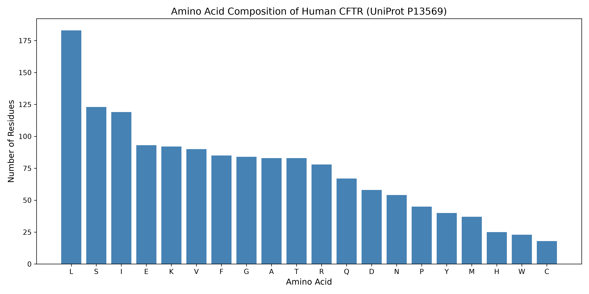
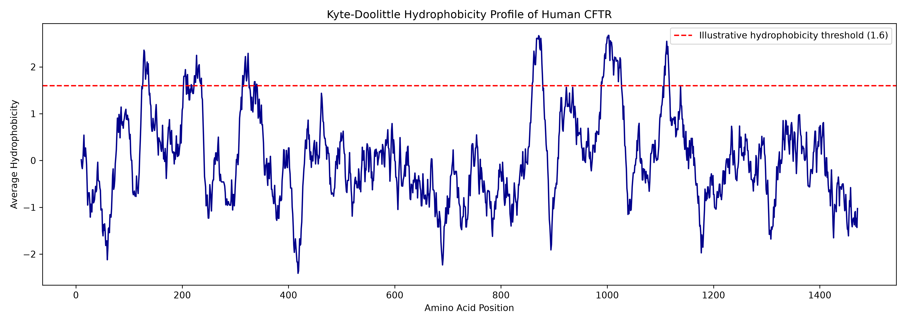
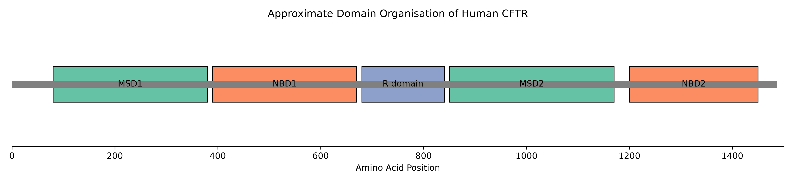

# CFTR Protein Sequence Analysis Using Python

## Project Overview

This exploratory bioinformatics project examines the amino acid composition, hydrophobicity profile and approximate domain organisation of the human cystic fibrosis transmembrane conductance regulator (CFTR).

The analysis uses Python and the canonical human CFTR protein sequence from UniProt (P13569).

## Research Aim

To characterise basic sequence properties of CFTR and explore how its amino acid sequence relates to its role as a membrane-associated ion channel.

## Data and Methods

- **Protein:** Cystic fibrosis transmembrane conductance regulator (CFTR)
- **Organism:** Homo sapiens
- **UniProt accession:** P13569
- **Sequence length:** 1,480 amino acids
- **Input format:** FASTA
- **Programming language:** Python
- **Libraries:** collections, NumPy and Matplotlib

The analysis includes:

1. FASTA sequence loading and length verification.
2. Amino acid frequency counting using Python's `Counter`.
3. Amino acid composition visualisation.
4. Kyte–Doolittle hydrophobicity profiling using a 19-residue sliding window.
5. Visualisation of approximate CFTR structural regions.

## Results

### 1. Amino Acid Composition

Amino acid frequency analysis identified leucine (L), serine (S) and isoleucine (I) among the most abundant residues in the canonical CFTR sequence.

### 2. Hydrophobicity Profile

The Kyte–Doolittle hydrophobicity profile reveals multiple hydrophobic regions, including peaks broadly consistent with the membrane-spanning portions of CFTR.

A 19-residue sliding window was used to calculate local average hydrophobicity. The dashed threshold is illustrative rather than a validated transmembrane prediction cutoff.

### 3. Protein Domain Organisation

The diagram illustrates CFTR's major structural regions:

- **MSD1 and MSD2:** Membrane-spanning domains
- **NBD1 and NBD2:** Nucleotide-binding domains
- **R domain:** Regulatory region

Domain coordinates are approximate, manually specified ranges used for visualisation. They were not computationally predicted or extracted from an annotation database.

## Biological Significance

CFTR is an ATP-regulated chloride and bicarbonate channel. Variants affecting CFTR can impair ion transport and contribute to cystic fibrosis.

Sequence composition and hydrophobicity profiling provide an introduction to understanding how protein sequence relates to membrane association and structural organisation.

## Limitations

This is an exploratory sequence analysis, not a structural prediction or experimental validation study.

Hydrophobicity peaks alone cannot establish transmembrane helices or exact domain boundaries. The domain diagram is illustrative and should not be interpreted as a newly predicted protein architecture.

No disease-associated variants were computationally assessed in this project.

## Repository Contents

- `CFTR_Protein_Analysis.ipynb` — Jupyter Notebook containing Python code and analysis
- `CFTR_HUMAN.fasta` — canonical human CFTR amino acid sequence
- `CFTR_Amino_Acid_Composition.png` — amino acid frequency figure
- `CFTR_Hydrophobicity_Profile.png` — sliding-window hydrophobicity figure
- `CFTR_Protein_Domains.png` — illustrative domain organisation diagram

## Data Source

UniProt Consortium. Human CFTR protein record (P13569).

https://www.uniprot.org/uniprotkb/P13569/entry

## Skills Demonstrated

Python programming, FASTA sequence handling, protein sequence analysis, amino acid composition analysis, sliding-window calculations, scientific visualisation and reproducible notebook documentation.
